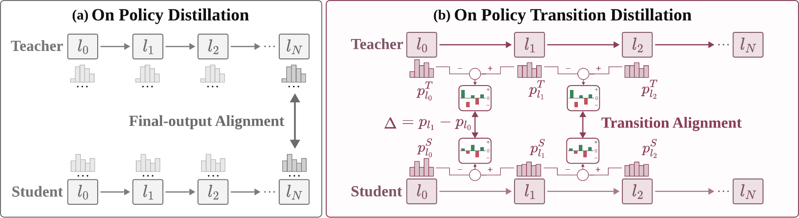

<div align="center">
  <h1>OPTD: On-Policy Transition Distillation</h1>
  <a href="https://arxiv.org/abs/2610.28048">
    
  </a>
  <a href="https://huggingface.co/papers/2610.28048">
    
  </a>
  <a href="https://modalitydance.github.io/optd/">
    
  </a>
  <a href="https://huggingface.co/collections/ModalityDance/optd">
    
  </a>
  <a href="./LICENSE">
    
  </a>
  <p>
    <a href="#quick-start">Quick start</a> ·
    <a href="#usage-example">Usage</a> ·
    <a href="#how-it-works">How it works</a> ·
    <a href="#checkpoints">Models</a> ·
    <a href="#inference">Inference</a> ·
    <a href="#community">Community</a> ·
    <a href="#citation">Citation</a>
  </p>
</div>

Code for **On-Policy Transition Distillation (OPTD)**, a method for transferring specialist capabilities into a single language model.


## Overview

As a language model processes a prompt, its predictions change from layer to layer. These changes reveal how the model gradually builds its prediction. Can a student learn from this process as well as from the teacher's final prediction?

OPTD brings this additional supervision to **on-policy distillation**, where the student generates responses and learns from a teacher's predictions on those same responses. Alongside matching the teacher's final prediction, OPTD trains the student to match **how the teacher changes its predictions across layers**.



For a given response prefix, we compare how teacher and student change the log probability of the same candidate token between two selected layers. This gives the student a training signal about the teacher's prediction changes along that part of the network. We apply this supervision across selected layer segments while retaining the standard final-output distillation objective.

We study OPTD with DeepSeek-R1-Distill-Qwen-1.5B/7B and Qwen3-4B, using specialists in mathematics, coding, and instruction following. Each training prompt is supervised by the specialist for its domain. See [How it works](#how-it-works) and [method details](docs/method.md).

## Quick Start

Released checkpoints can be loaded without this environment. The steps below install the training stack, point it at the paper's models and data, and launch one OPTD run.

### Installation

Use Linux with NVIDIA GPUs, a CUDA-12-compatible driver, and Python 3.12:

```bash
conda create -n optd python=3.12 -y
conda activate optd
bash scripts/setup_oprd_env.sh
```

Single-prompt generation only needs PyTorch, Transformers, and Accelerate. See [Usage Example](#usage-example).

### Data

Download a student and its domain teachers, then prepare the training data using the [data preparation guide](docs/data.md). The guide lists the models and datasets used in the paper.

Set the local paths and available GPUs. Coding tasks also require a running SandboxFusion service:

```bash
export ACTOR_MODEL_PATH=/path/to/student
export REWARD_MODEL_PATH=/path/to/math_teacher
export SECONDARY_REWARD_MODEL_PATH=/path/to/code_teacher
export TRAIN_DATASET=/path/to/prepared_train.parquet
export CUDA_VISIBLE_DEVICES=0,1,2,3
export SANDBOX_FUSION_URL=http://127.0.0.1:8080/run_code
```

### Running

Train Qwen3-4B with the paper's Late configuration:

```bash
python scripts/train.py --config configs/4b_late.json --method optd
```

To run the OPD baseline with the same configuration, use `--method opd`. Add `--dry-run` to inspect the settings before launching a job.

The [training guide](docs/training.md) covers the other model sizes, the three-domain setting, configuration options, and tests. Models, datasets, and trained checkpoints are separate from this source release.

## Usage Example

Released checkpoints are complete models. A typical use is to load one checkpoint, format a prompt, and generate. Training a new student is covered in [Quick Start](#quick-start).

```python
import torch
from transformers import AutoModelForCausalLM, AutoTokenizer

# 1) Load a released OPTD model (tokenizer included)
model_id = "models/optd-qwen3-4b-late"  # or a Hub id such as ModalityDance/OPTD-Qwen3-4B-Late
tokenizer = AutoTokenizer.from_pretrained(model_id)
model = AutoModelForCausalLM.from_pretrained(
    model_id, torch_dtype=torch.bfloat16, device_map="auto"
)

# 2) Prepare a task prompt. Qwen3-4B Mid/Late use non-thinking mode.
#    R1-Distill checkpoints omit enable_thinking=False.
messages = [{"role": "user", "content": "Solve 2x + 5 = 17."}]
text = tokenizer.apply_chat_template(
    messages, tokenize=False, add_generation_prompt=True, enable_thinking=False
)

# 3) Generate and inspect the completion
inputs = tokenizer(text, add_special_tokens=False, return_tensors="pt").to(model.device)
with torch.inference_mode():
    output = model.generate(
        **inputs, max_new_tokens=1024, do_sample=True, temperature=0.7, top_p=0.95
    )
print(tokenizer.decode(output[0, inputs.input_ids.shape[-1]:], skip_special_tokens=True))
```

`max_new_tokens=1024` is only for this short prompt. Paper evaluation uses benchmark-specific limits. Download commands, the reasoning-mode variant, and dataset generation are in [Inference](#inference). The same snippet is on each [model card](docs/model_cards/OPTD-Qwen3-4B-Late.md).

## How It Works

OPTD is a modular on-policy distillation pipeline. Representation, teacher supervision, and the student update are separate stages, so the final-policy objective, the layer path, and the domain teachers can be changed without rewriting the rest of the trainer.

At a high level, the workflow proceeds as follows:

1. **On-policy generation** — The student samples a response for each training prompt. The prompt is routed to the specialist for its domain (mathematics, coding, or instruction following).
2. **Transition comparison** — On the same response prefix and the same candidate tokens, teacher and student log probabilities are read at selected layers. Each segment contributes the change in log probability between its source and destination layer. The student is trained to match the teacher’s increments, using candidates from the teacher’s final-policy top-16 support.
3. **Joint distillation** — The frozen teacher also supplies the usual final-layer distribution match. OPTD adds the transition losses, equally weighted across the selected path, to that final-policy objective.

Mid and Late name where those layers sit in the network. They are experimental variants, not successive releases. The practical update, layer indices, and the relation to reverse transition KL are in [method details](docs/method.md).

## Checkpoints

Six trained OPTD models are available for inference and evaluation. Choose a model size and the training domains relevant to your task:

| Base model | Training domains | Available models | Generation mode |
| --- | --- | --- | --- |
| R1-Distill-Qwen-1.5B | Math + coding | [Mid](https://huggingface.co/ModalityDance/OPTD-DeepSeek-R1-Distill-Qwen-1.5B-Mid) · [Late](https://huggingface.co/ModalityDance/OPTD-DeepSeek-R1-Distill-Qwen-1.5B-Late) | Reasoning |
| R1-Distill-Qwen-1.5B | Math + coding + instruction following | [Three-domain](https://huggingface.co/ModalityDance/OPTD-DeepSeek-R1-Distill-Qwen-1.5B-ThreeDomain) | Reasoning |
| Qwen3-4B | Math + coding | [Mid](https://huggingface.co/ModalityDance/OPTD-Qwen3-4B-Mid) · [Late](https://huggingface.co/ModalityDance/OPTD-Qwen3-4B-Late) | Non-thinking |
| R1-Distill-Qwen-7B | Math + coding | [Late](https://huggingface.co/ModalityDance/OPTD-DeepSeek-R1-Distill-Qwen-7B-Late) | Reasoning |

**Mid** and **Late** refer to where transition supervision is applied during training: Late shifts the selected layers deeper into the network. They are experimental variants, not successive releases or a ranking of model quality. **Three-domain** adds an instruction-following specialist to math and coding supervision.

Each release is a complete model with its tokenizer. The [inference](#inference) section downloads every checkpoint and runs it on the paper's datasets. [Inference notes](docs/inference.md) record the pinned release revisions and checksums.

## Inference

Released checkpoints load with Transformers or vLLM. A teacher model is required only when training a new student.

Single-prompt generation needs PyTorch, Transformers, and Accelerate. Dataset generation uses the [Quick Start](#installation) environment, which installs vLLM 0.11.0. Coding benchmarks also need a SandboxFusion service at `http://127.0.0.1:8080/run_code`.

```bash
python -m pip install torch transformers accelerate huggingface_hub
```

### Download

`hf download` fetches the full checkpoint and tokenizer at the release revision. The same repository id can be passed straight to `from_pretrained` or vLLM.

```bash
# R1-Distill-Qwen-1.5B, math + coding, Mid (reasoning)
hf download ModalityDance/OPTD-DeepSeek-R1-Distill-Qwen-1.5B-Mid \
  --revision 800ec92fe578870e74df401a400a2b51a801ac99 \
  --local-dir models/optd-deepseek-r1-distill-qwen-1.5b-mid

# R1-Distill-Qwen-1.5B, math + coding, Late (reasoning)
hf download ModalityDance/OPTD-DeepSeek-R1-Distill-Qwen-1.5B-Late \
  --revision 57241e09a7ebd5a36c80897c69c17fd9a0ae7901 \
  --local-dir models/optd-deepseek-r1-distill-qwen-1.5b-late

# R1-Distill-Qwen-1.5B, math + coding + instruction following (reasoning)
hf download ModalityDance/OPTD-DeepSeek-R1-Distill-Qwen-1.5B-ThreeDomain \
  --revision 12485f39c4628521ff6f784978a176003197a7df \
  --local-dir models/optd-deepseek-r1-distill-qwen-1.5b-threedomain

# Qwen3-4B, math + coding, Mid (non-thinking)
hf download ModalityDance/OPTD-Qwen3-4B-Mid \
  --revision 45e4f740ee974959c99ef6e9ab97a1ec2b386fb5 \
  --local-dir models/optd-qwen3-4b-mid

# Qwen3-4B, math + coding, Late (non-thinking)
hf download ModalityDance/OPTD-Qwen3-4B-Late \
  --revision c628ec8524a1564d62b83c163c0f2c479c7216f8 \
  --local-dir models/optd-qwen3-4b-late

# R1-Distill-Qwen-7B, math + coding, Late (reasoning)
hf download ModalityDance/OPTD-DeepSeek-R1-Distill-Qwen-7B-Late \
  --revision e9b49f3c9b33fd3667808cd4eafa6512176051a9 \
  --local-dir models/optd-deepseek-r1-distill-qwen-7b-late
```

| Size | Checkpoint | Local directory |
| --- | --- | --- |
| 1.5B Mid | [ModalityDance/OPTD-DeepSeek-R1-Distill-Qwen-1.5B-Mid](https://huggingface.co/ModalityDance/OPTD-DeepSeek-R1-Distill-Qwen-1.5B-Mid) | `models/optd-deepseek-r1-distill-qwen-1.5b-mid` |
| 1.5B Late | [ModalityDance/OPTD-DeepSeek-R1-Distill-Qwen-1.5B-Late](https://huggingface.co/ModalityDance/OPTD-DeepSeek-R1-Distill-Qwen-1.5B-Late) | `models/optd-deepseek-r1-distill-qwen-1.5b-late` |
| 1.5B Three-domain | [ModalityDance/OPTD-DeepSeek-R1-Distill-Qwen-1.5B-ThreeDomain](https://huggingface.co/ModalityDance/OPTD-DeepSeek-R1-Distill-Qwen-1.5B-ThreeDomain) | `models/optd-deepseek-r1-distill-qwen-1.5b-threedomain` |
| 4B Mid | [ModalityDance/OPTD-Qwen3-4B-Mid](https://huggingface.co/ModalityDance/OPTD-Qwen3-4B-Mid) | `models/optd-qwen3-4b-mid` |
| 4B Late | [ModalityDance/OPTD-Qwen3-4B-Late](https://huggingface.co/ModalityDance/OPTD-Qwen3-4B-Late) | `models/optd-qwen3-4b-late` |
| 7B Late | [ModalityDance/OPTD-DeepSeek-R1-Distill-Qwen-7B-Late](https://huggingface.co/ModalityDance/OPTD-DeepSeek-R1-Distill-Qwen-7B-Late) | `models/optd-deepseek-r1-distill-qwen-7b-late` |

Point `MODEL` at one directory from the table. Dataset commands below read `$MODEL`. The default is 4B Late.

```bash
# Qwen3-4B Mid or Late. These two checkpoints use non-thinking mode.
export MODEL=models/optd-qwen3-4b-late

# R1-Distill 1.5B Mid, 1.5B Late, 1.5B Three-domain, or 7B Late.
# export MODEL=models/optd-deepseek-r1-distill-qwen-1.5b-late
```

### Single example

Qwen3-4B Mid and Late keep `enable_thinking=False`. R1-Distill 1.5B and 7B use the tokenizer's reasoning chat template, so omit that argument. Because the chat string is already formatted, `add_special_tokens=False` avoids adding special tokens a second time. `max_new_tokens=1024` is only for this short prompt.

```python
import torch
from transformers import AutoModelForCausalLM, AutoTokenizer

# Qwen3-4B Mid or Late. For an R1-Distill checkpoint, set model_id to that
# local directory or Hub id and drop enable_thinking=False below.
model_id = "models/optd-qwen3-4b-late"
tokenizer = AutoTokenizer.from_pretrained(model_id)
model = AutoModelForCausalLM.from_pretrained(
    model_id, torch_dtype=torch.bfloat16, device_map="auto"
)
messages = [{"role": "user", "content": "Solve 2x + 5 = 17."}]
text = tokenizer.apply_chat_template(
    messages, tokenize=False, add_generation_prompt=True, enable_thinking=False
)
inputs = tokenizer(text, add_special_tokens=False, return_tensors="pt").to(model.device)
with torch.inference_mode():
    output = model.generate(
        **inputs, max_new_tokens=1024, do_sample=True, temperature=0.7, top_p=0.95
    )
response = output[0, inputs.input_ids.shape[-1]:]
print(tokenizer.decode(response, skip_special_tokens=True))
```

R1-Distill 1.5B Mid, 1.5B Late, 1.5B Three-domain, and 7B Late:

```python
model_id = "models/optd-deepseek-r1-distill-qwen-1.5b-late"
text = tokenizer.apply_chat_template(
    messages, tokenize=False, add_generation_prompt=True
)
```

### Mathematics: AIME24, AIME25, AIMO

Prepare `datasets/test_data/{AIME24,AIME25,AIMO}/test.parquet` as described in the [data guide](docs/data.md). Generation is Avg@16 at temperature 0.7, top-p 0.95, and 31,744 new tokens.

Qwen3-4B passes `--no-enable-thinking`. R1-Distill 1.5B and 7B leave thinking enabled (the script default).

```bash
# Qwen3-4B Mid or Late
PYTHONPATH="$PWD/verl" python scripts/val/eval/eval_checkpoint_vllm.py \
  --model-path "$MODEL" \
  --data-dir datasets/test_data \
  --output-dir outputs/math \
  --tasks AIME24 AIME25 AIMO --n 16 \
  --no-enable-thinking

# R1-Distill 1.5B or 7B: drop --no-enable-thinking
PYTHONPATH="$PWD/verl" python scripts/val/eval/eval_checkpoint_vllm.py \
  --model-path "$MODEL" \
  --data-dir datasets/test_data \
  --output-dir outputs/math \
  --tasks AIME24 AIME25 AIMO --n 16

PYTHONPATH="$PWD/verl" python scripts/val/eval/grade.py --eval-dir outputs/math
```

### Coding: LiveCodeBench v5

LiveCodeBench v5 is 279 problems. Report Avg@8 and Pass@8 from two independently generated n=4 batches. Qwen3-4B adds `--non-thinking`; R1-Distill omits it.

```bash
# Batch A. Qwen3-4B Mid or Late:
PYTHONPATH="$PWD/verl" python scripts/val/eval/run_lcb_eval.py \
  --model-path "$MODEL" \
  --data-glob '/path/to/lcbv5/test-*.parquet' \
  --output-prefix outputs/lcb/batch_a \
  --sandbox-url http://127.0.0.1:8080/run_code \
  --non-thinking

# R1-Distill 1.5B or 7B: the same command without --non-thinking.

# Batch B uses a new output prefix and a fresh generation.
PYTHONPATH="$PWD/verl" python scripts/val/eval/run_lcb_eval.py \
  --model-path "$MODEL" \
  --data-glob '/path/to/lcbv5/test-*.parquet' \
  --output-prefix outputs/lcb/batch_b \
  --sandbox-url http://127.0.0.1:8080/run_code \
  --non-thinking

python scripts/val/eval/merge_lcb_n8_complete.py \
  --first-generation outputs/lcb/batch_a.jsonl \
  --first-graded outputs/lcb/batch_a.graded.jsonl \
  --second-generation outputs/lcb/batch_b.jsonl \
  --second-graded outputs/lcb/batch_b.graded.jsonl \
  --output-dir outputs/lcb/n8
```

### Coding: CodeContests

The 165-problem CodeContests subset is Avg@16. Qwen3-4B adds `--non-thinking`.

```bash
PYTHONPATH="$PWD/verl" python scripts/val/eval/run_deepmind_codecontests165_eval.py \
  --model-path "$MODEL" \
  --data /path/to/codecontests165.parquet \
  --output-prefix outputs/codecontests/run --n 16 \
  --sandbox-url http://127.0.0.1:8080/run_code \
  --non-thinking
```

Drop `--non-thinking` for R1-Distill 1.5B and 7B. A finished run covers 165 problems and 2,640 generated and graded candidates.

### Coding: Codeforces

The shipped generator scores 408 canonical problems at n=8 and always applies `enable_thinking=False`, for every model size. The parquet glob must match one shard. Elo still needs the external contest metadata and rating harness; generation output alone is not an Elo estimate. See the [evaluation guide](docs/evaluation.md).

```bash
PYTHONPATH="$PWD/verl" python scripts/val/eval/eval_codeforces_codeelo_vllm.py \
  --repo "$PWD" \
  --model "$MODEL" \
  --data-glob '/path/to/codeforces/test.parquet' \
  --output outputs/codeforces
```

### Instruction following: IFEval

IFEval uses the original benchmark checker, 16 samples, and the mean of strict and loose prompt and instruction accuracy. This repository does not include that checker. The three-domain checkpoint is the 1.5B model trained with an instruction-following specialist:

```text
models/optd-deepseek-r1-distill-qwen-1.5b-threedomain
```

Run the same checker on the other five checkpoints when comparing sizes. Keep the model's generation mode: reasoning for every R1-Distill checkpoint, `enable_thinking=False` for both Qwen3-4B checkpoints.

Sampling settings, merge checks, and grading coverage are in the [evaluation guide](docs/evaluation.md). Release commits and file hashes are in [inference notes](docs/inference.md).

## Evaluation

We evaluate mathematics on AIME24/25 and AIMO; coding on LiveCodeBench v5, CodeContests, and Codeforces; and instruction following on IFEval.

The commands in [Inference](#inference) run those datasets for each released model size. The [evaluation guide](docs/evaluation.md) records benchmark protocols, coverage checks, and required external resources.

## Community

- Models: [ModalityDance/optd](https://huggingface.co/collections/ModalityDance/optd)
- Paper: [arXiv:2610.28048](https://arxiv.org/abs/2610.28048) · [Hugging Face Paper](https://huggingface.co/papers/2610.28048)
- Questions about reproducing a run belong in the repository issues, with the config name and `--dry-run` output

## Acknowledgements

This implementation builds on OPD and verl. See [third-party notices](THIRD_PARTY_NOTICES.md), the [repository license](LICENSE), and the [verl license](verl/LICENSE).

## Citation


```bibtex
@misc{optd2026,
  title         = {On-Policy Transition Distillation},
  author        = {You, Runyang and Li, Yongqi and Yu, Tiezheng and Li, Wenjie},
  year          = {2026},
  eprint        = {2610.28048},
  archivePrefix = {arXiv},
  primaryClass  = {cs.CL},
  url           = {https://arxiv.org/abs/2610.28048}
}
```
